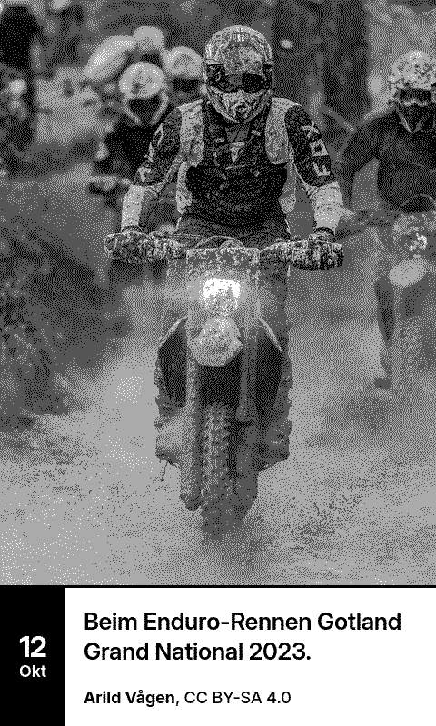
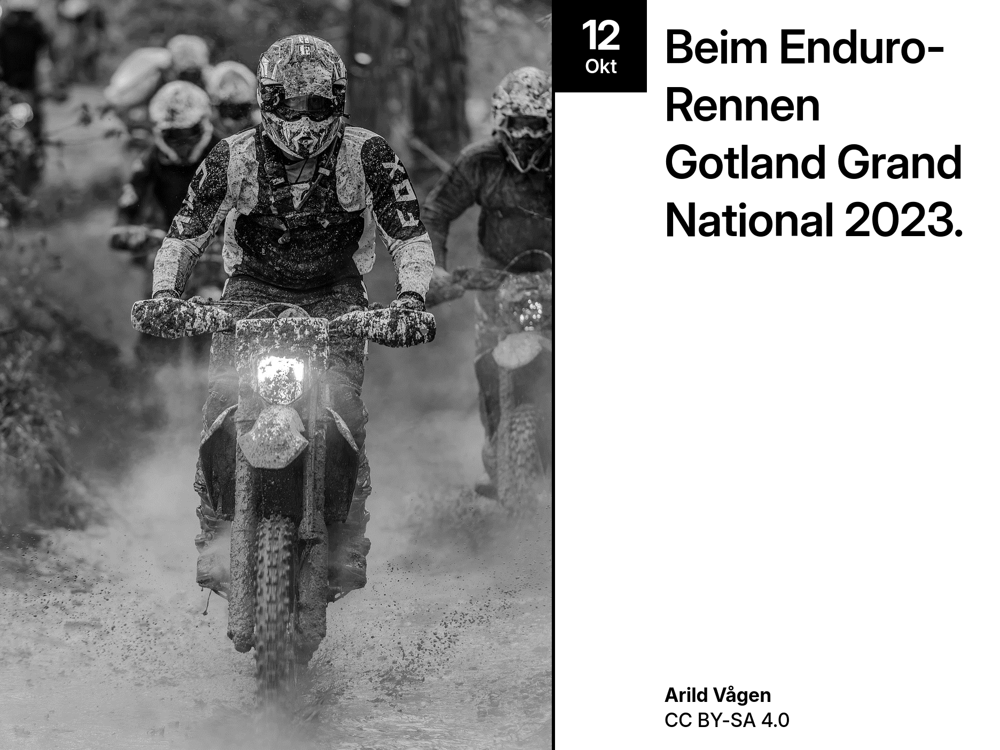
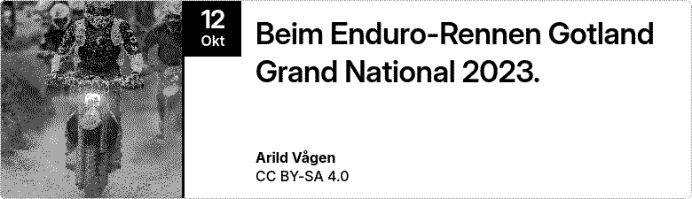
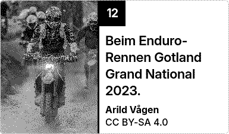

# Picture of the Day

Wikimedia Commons' Picture of the Day for [TRMNL](https://trmnl.com) e-paper displays: one outstanding, freely licensed photo every day, with a short caption, the photographer and the licence.


| Portrait | TRMNL X | Half (vertical) |
|---|---|---|
|  |  |  |

| Half (horizontal) | Quadrant |
|---|---|
|  |  |

## Features

- The picture chosen each day by the Wikimedia Commons community
- Layout adapts to the picture: wide photos get a caption band below, tall photos a caption beside them, never more than a quarter cropped
- Photographer and licence always on screen
- Captions in Czech, Dutch, English, German, Hungarian, Portuguese or Spanish (or follow the TRMNL account language), English when a translation is missing
- Dithered for TRMNL's grayscale and black-and-white screens
- All four TRMNL layouts (full, half horizontal, half vertical, quadrant), adapting to portrait and to TRMNL X

## Data

Pictures and captions come from the [Wikimedia Commons Picture of the Day](https://commons.wikimedia.org/wiki/Commons:Picture_of_the_day) through the public MediaWiki API. No account or API key is needed.

Each picture is shown under its own free licence, named on screen with its author. This project is not affiliated with or endorsed by the Wikimedia Foundation.

## How it works

1. TRMNL polls Commons every 6 hours, twice: once for the day's file (size, thumbnail, author, licence) and once for its caption ([`src/settings.yml`](src/settings.yml)).
2. A serverless transform turns the caption's wikitext and the author's HTML into plain text ([`src/transform.py`](src/transform.py)).
3. The views pick a stacked or side-by-side layout from the picture's shape and the slot's size, in TRMNL's Inter font ([`src/shared.liquid`](src/shared.liquid)).

## Development

Uses [trmnlp](https://github.com/usetrmnl/trmnlp) through Docker, no Ruby needed:

```sh
bin/trmnlp serve   # live preview at http://localhost:4567
bin/trmnlp lint
bin/trmnlp test
```

The tests use real Commons responses for a tall (2026-10-12) and a wide (2026-10-11) picture, with German and English captions, in [`tests/fixtures`](tests/fixtures).

## License

Code: [MIT](LICENSE). Pictures: their own licences, as shown on screen.
